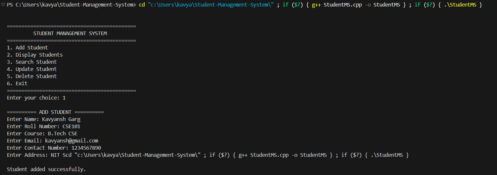

# Student Management System

A console-based Student Management System developed in C++ for managing student records efficiently.


## Overview

This project allows users to maintain student information through a simple menu-driven interface. Student records are stored in a text file so that the data remains available after the program is closed.

## Features

- Add new student records
- Display all student records
- Search students using roll number
- Update existing student information
- Delete student records
- Validate roll numbers
- Validate email addresses
- Validate 10-digit contact numbers
- Prevent duplicate roll numbers
- Persistent file-based data storage

## Technologies Used

- C++
- File Handling
- Structures
- Vectors
- Regular Expressions
- Standard Template Library (STL)

## Project Structure

```text
Student-Management-System/
│
├── StudentMS.cpp
├── README.md
├── .gitignore
├── LICENSE
└── demo.png
```

## Demo



The application provides a simple menu-driven interface for managing student records.

## How to Run

### 1. Clone the repository

```bash
git clone https://github.com/KavyanshGarg/Student-Management-System.git
```

### 2. Open the project

Open the project folder in Visual Studio Code.

### 3. Compile the program

```bash
g++ StudentMS.cpp -std=c++17 -o StudentMS
```

### 4. Run the program

On Windows:

```bash
StudentMS.exe
```

On Linux/macOS:

```bash
./StudentMS
```

## Data Storage

The application stores student records in a local file named:

```text
students.txt
```

The file is created automatically when student data is saved.

The `students.txt` file is excluded from Git using `.gitignore` so that local student records are not uploaded to the repository.

## Menu

```text
============================================
         STUDENT MANAGEMENT SYSTEM
============================================
1. Add Student
2. Display Students
3. Search Student
4. Update Student
5. Delete Student
6. Exit
============================================
```

## Project Purpose

The project demonstrates practical implementation of:

- C++ programming
- CRUD operations
- File handling
- Input validation
- Data structures
- Menu-driven application development

## Future Improvements

- Graphical user interface
- Database integration
- Student sorting and filtering
- Export records to CSV
- Authentication and role-based access

## Author

**Kavyansh Garg**

## License

This project is licensed under the MIT License.